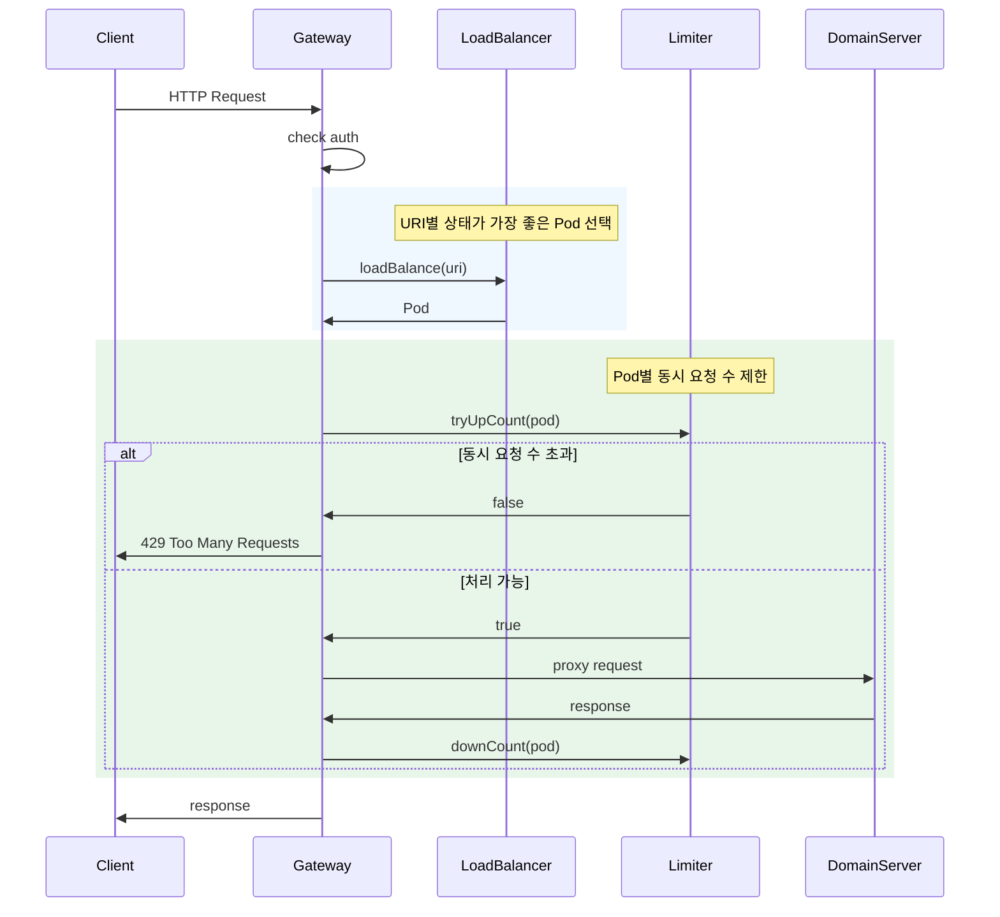
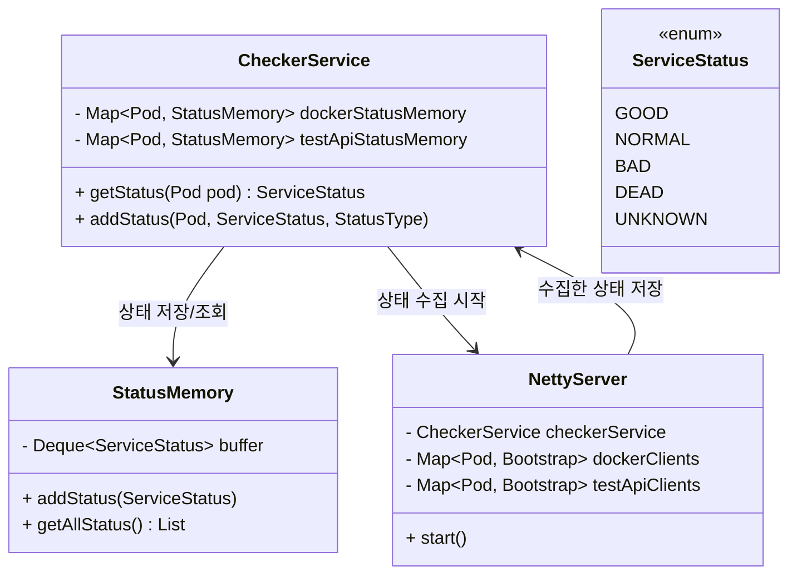
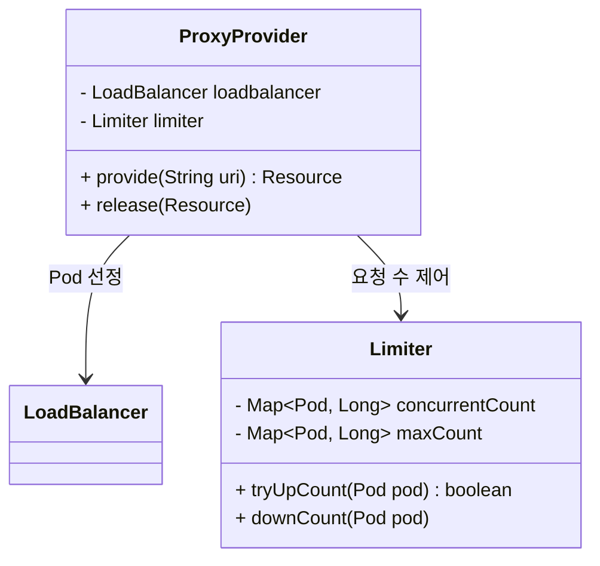

# Gateway

## 목차
1. 주요 기능 / 전체 흐름도
2. ping test 결과
3. 기능 별 상세 내용

 

## 1. 주요 기능 / 전체 흐름도

Gateway는 모든 요청을 받아 인증을 처리하고, 요청 URI에 맞는 도메인 서버(Pod)를 골라 프록시하는 서버입니다.

1. **Proxy** — 모든 요청을 알맞은 도메인 서버로 전달
2. **Auth** — 요청 단계에서 인증 처리
3. **Load Balancer** — URI와 서버 상태를 고려해 전달할 Pod 선정
4. **Limiter** — Pod별 동시 처리 요청 수를 제한해 과부하 방지

 

## 2. ping test 결과

- **환경**: Gateway 컨테이너 리소스 제한 0.2 CPU / 128m
- **도구**: k6
- **처리 시간**: p100 (최댓값) 기준

| 초당 Request | 처리 시간 (p100) |
|:--:|:--:|
| 50 | 83ms |
| 60 | 95ms |

 

## 3. 기능 별 상세 내용

### 3-1. Proxy Server

**구현 목표**
- 모든 요청을 알맞은 도메인 서버로 프록시한다
- 요청 단계에서 인증(Auth)을 처리한다

**사용 라이브러리** · Netty

Spring Boot 컨테이너 4개를 프록시하려면 더 고성능의 라이브러리가 필요했습니다. Netty는 이벤트 기반의 논블로킹 I/O로 적은 스레드로 많은 연결을 처리할 수 있어, 요청을 중계하는 Proxy Server에 매우 적합했습니다.

 

### 3-2. Load Balancer

**구현 목표** · 요청 URI와 서버 상태를 고려해 프록시할 Pod를 선정한다

1. 요청 URI로 처리할 서비스를 결정한다
2. 해당 서비스의 인스턴스 중 상태가 가장 좋은 대상을 선정한다
3. 일정 주기로 모든 인스턴스의 상태를 조사하고 관리한다

**Status 관리**

서비스 인스턴스의 상태는 `GOOD · NORMAL · BAD · DEAD · UNKNOWN` 다섯 단계로 분리해 관리하고, Netty를 통해 주기적으로 수집합니다.

CheckerService가 인스턴스별로 최근 상태를 `StatusMemory`(최근 N개 버퍼)에 쌓아 두고, LoadBalancer는 매 요청마다 상태가 가장 좋은 인스턴스를 골라 프록시합니다. 상태 수집은 별도의 `NettyServer`가 각 인스턴스에 비동기로 연결해 주기적으로 갱신합니다.

 

### 3-3. Limiter (요청 제한)

**구현 목표** · 인스턴스별 동시 처리 요청 수를 정해진 개수 이하로 유지한다 (ex: User 서비스의 동시 요청을 6개 이하로)

도메인 서버가 감당할 수 있는 양을 넘는 요청이 몰리면 컨테이너가 죽을 수 있습니다. Limiter는 인스턴스마다 현재 처리 중인 요청 수를 세어, 상한을 넘으면 새 요청을 받지 않고 `429 Too Many Requests`로 되돌립니다.

- 프록시를 시작할 때 `tryUpCount`로 카운트를 올리고, 상한을 넘으면 거절
- 응답이 끝나면 `downCount`로 카운트를 내림
- 카운트 증감은 인스턴스 단위로 `synchronized` 처리해 동시성 보장

