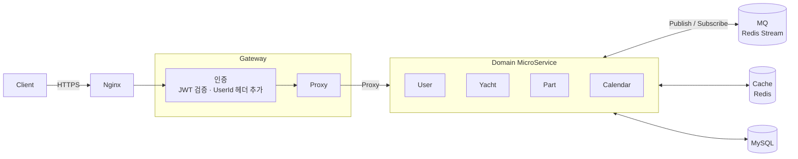

# HooYah — 요트 통합 관리 앱 (MSA)

요트를 등록하고 부품별 정비 이력과 다음 정비 시점을 관리하는 요트 통합 관리 앱의 백엔드입니다.
팀 프로젝트로 완성한 모놀리식 서비스를 도메인 단위로 분리해 MSA로 재구성했습니다.

- 기간 : 2026.01 ~ 2026.03
- 구분 : 고용노동부 프로젝트 ([HooAah-Yacht/backend](https://github.com/HooAah-Yacht/backend))
- 배포 : Raspberry Pi 4 (RAM 4Gi) · Docker

## 1. 모듈 구성

### Gateway

| 모듈 | 역할 | Port | 문서 |
|---|---|---|---|
| Gateway | Proxy · 인증 · Load Balance · Health Check · 요청 수 제한 | 9090 | [README](./Gateway/README.md) |

### 공통

| 모듈 | 역할 | 문서 |
|---|---|---|
| Cache | Redis Cache 라이브러리. Redis 연결 실패 시 InMemory Cache로 자동 전환 | [README](./Cache/README.md) |
| message | Redis Stream 기반 Message Queue Template (Publish / Subscribe) | [README](./message/README.md) |
| common | 공통 WebClient · SuccessResponse · ErrorCode · ListUtil | [README](./common/README.md) |

### Domain MicroService

| 모듈 | 역할 | 담당 URI | Port | 문서 |
|---|---|---|---|---|
| User | 회원가입 · 로그인(JWT 발급) · 회원 정보 | `/user/` | 9091 | [README](./User/README.md) |
| Yacht | 요트 · 요트 멤버 · 초대 코드 | `/yacht/` | 9092 | [README](./Yacht/README.md) |
| Part | 부품 · 수리 내역 | `/part/` `/repair/` | 9093 | [README](./part/README.md) |
| Calendar | 정비 일정 · 푸시 알림 | `/calendar/` `/alarm/` | 9094 | [README](./calendar/README.md) |

## 2. 요청 흐름

## 3. 기술 스택

| 구분 | 사용 기술 |
|---|---|
| Language | Java 21 |
| Framework | Spring Boot · JPA |
| Gateway | Netty |
| Database | MySQL 8.0 |
| Cache | Redis · [Jedis](https://github.com/redis/jedis) · [commons-pool2](https://commons.apache.org/proper/commons-pool/) |
| MQ | Redis 7 (Redis Stream) |
| Infra | Docker · Nginx · Raspberry Pi 4 |
| Test | JUnit · K6 |

## 4. 성능 Test

### 테스트 환경

Raspberry Pi 4 (RAM 4Gi) · [`docker-compose.yml`](./docker-compose.yml)

| Container | Image | Memory | CPU |
|---|---|---|---|
| msa-gateway | amazoncorretto:21-alpine-jdk | 128m | 0.2 |
| msa-user | amazoncorretto:21-alpine-jdk | 300m | 0.35 |
| msa-yacht | amazoncorretto:21-alpine-jdk | 300m | 0.35 |
| msa-part | amazoncorretto:21-alpine-jdk | 300m | 0.35 |
| msa-calendar | amazoncorretto:21-alpine-jdk | 300m | 0.35 |
| msa-redis (Cache) | redis:7.2 | 300m | 0.35 |
| msa-mq (MQ) | redis:7.2 | 256m | 0.35 |
| mysql | mysql:8.0 | (작성 필요) | (작성 필요) |
